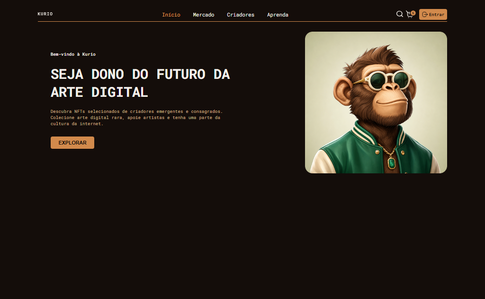

# 🎮 Jungle Gaming

Projeto desenvolvido como parte do **Teste Técnico** da empresa **Jungle Gaming** para a vaga de **Junior Front End Developer**.

A proposta consiste no desenvolvimento de uma interface de marketplace de NFTs.

Este repositório contém uma implementação parcial da página inicial para desktop, com foco na estruturação dos componentes e na construção da interface utilizando React.

## 📸 Captura de Tela


## 🚀 Tecnologias Utilizadas

<p align="left">
   
   
   
   
   
</p>

## 📚 Funcionalidades Implementadas

- **Banner Principal**: Implementação da seção de destaque da página inicial.
- **Componentização**: Organização da interface utilizando componentes React.
- **Header**: Estruturação do cabeçalho da aplicação.
- **Navegação**: Criação dos links de navegação da página inicial.
- **Organização de Assets**: Utilização de imagens e ícones SVG nos componentes.

## ▶️ Como Rodar o Projeto
Siga os passos abaixo para rodar a aplicação localmente:

1. **Clone esse repositório:**

   ```
   git clone https://github.com/jonatasoliveiradasilva/jungle-gaming
   
   cd jungle-gaming
2. **Instale as dependências:**

   ```
   npm install
3. **Inicie o servidor de desenvolvimento:**

   ```
   npm run dev   
**Acesse a aplicação no navegador:**

## 📌 Considerações Finais

- O projeto representa uma etapa do meu processo de aprendizado e desenvolvimento de habilidades em Front End.
- Embora a implementação não esteja completa, foi possível praticar a estruturação da interface, a componentização com React e a estilização utilizando SASS.
- Estou em constante aprendizado e aberto a feedbacks que contribuam para minha evolução profissional.